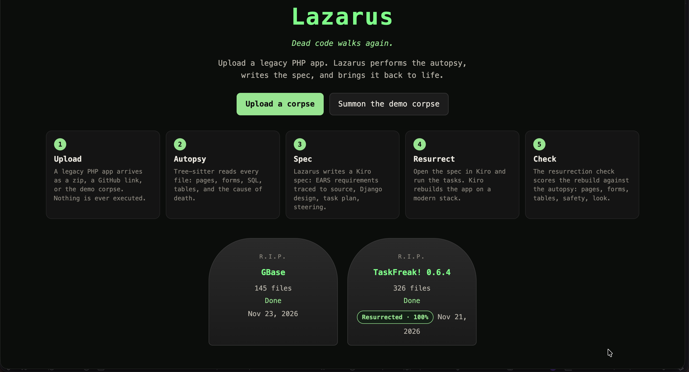
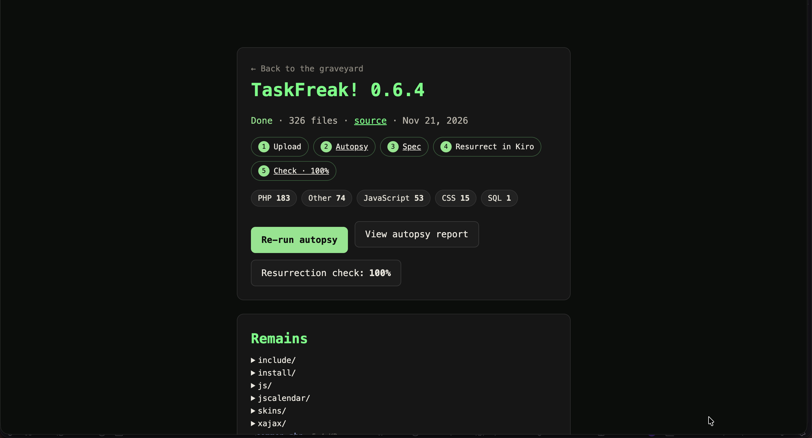
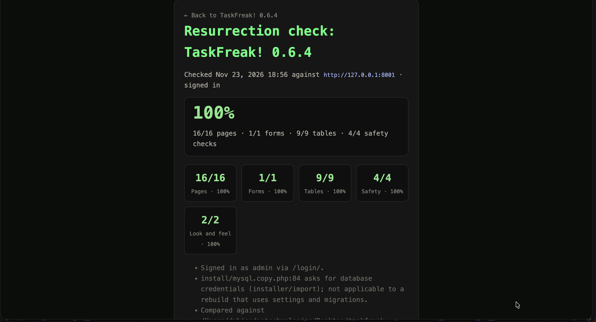
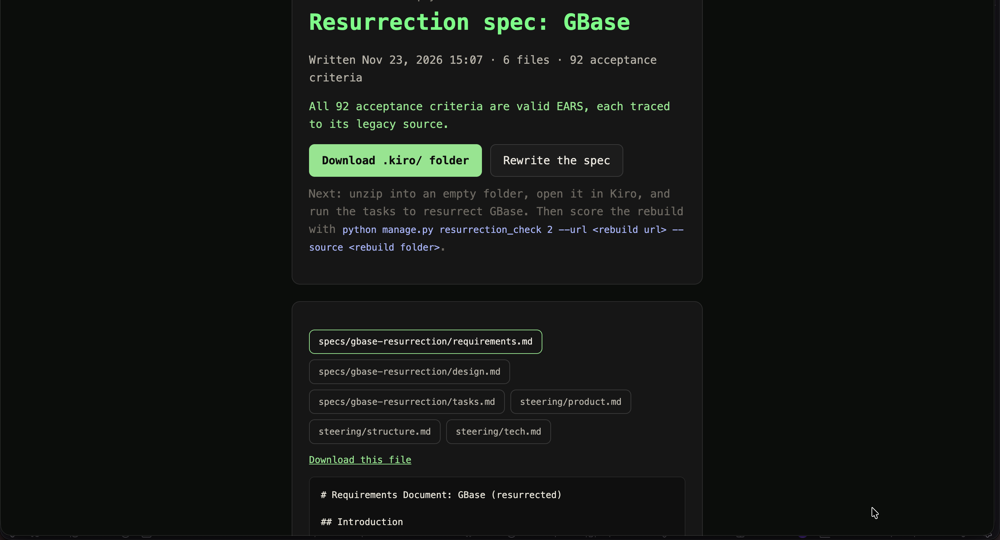

# Lazarus

**Dead code walks again.**

Lazarus brings abandoned PHP apps back to life. Give it a zip or a GitHub link. It performs an autopsy on the code, works out why the app died, and writes a complete [Kiro](https://kiro.dev) spec for rebuilding it on a modern stack. Kiro then does the rebuild, and Lazarus scores the result against the original.

Built for **Kiroween 2026**, Resurrection category.



---

## The corpse

[TaskFreak! 0.6.4](https://sourceforge.net/projects/taskfreak/) was a popular little PHP task manager from around 2010. Try to run it today and it never gets past setup:

- `session_unregister()` was removed in PHP 5.4. The login page dies with a fatal error.
- The whole `mysql_*` extension was removed in PHP 7.0.
- The installer creates its tables with `TYPE=MyISAM`, which MySQL has refused since 5.5.

The code is still on SourceForge, but nothing modern can run it. It is dead in every way that counts.

## The resurrection

| Stage | What Lazarus found or did |
|---|---|
| Autopsy | 45 PHP files and 13,842 lines read. 16 pages, 9 forms, 103 SQL statements and 9 tables mapped. 2 bundled libraries (jscalendar, xajax) and 14 stylesheets identified. |
| Cause of death | 70 calls to 18 functions removed in PHP 5.4, 7.0 and 8.0, across 16 files. Plus 18 uses of SQL syntax that modern MySQL rejects (`TYPE=`), in 2 files. |
| Spec | 156 acceptance criteria, all valid EARS, each traced to `file:line` in the legacy source. Django design, a task plan, steering files, and the original stylesheets as `legacy-assets/`. |
| Rebuild | Kiro ran the task plan start to finish and produced a Django 6 app that keeps TaskFreak's look: logo, red bar, skin and language selectors. |
| Check | **100%**: 16/16 pages · 1/1 forms · 9/9 tables · 4/4 safety checks · 2/2 look and feel. |





### Not just TaskFreak

Lazarus makes no assumptions about which app it gets. GBase, a second legacy PHP project imported straight from its GitHub URL, went through the same pipeline: 145 files in, 92 EARS criteria out, all traced to source.



---

## How it works

1. **Upload.** A zip (up to 20 MB, 500 files) or a public GitHub URL. Archives are unpacked safely: path traversal, symlinks and zip bombs are all rejected. **Uploaded code is never executed.**
2. **Autopsy.** [tree-sitter-php](https://github.com/tree-sitter/tree-sitter-php) parses every PHP file. Lazarus finds the pages (entry points nothing else includes), forms and their fields, the SQL each page runs, and the schema. It also finds removed functions, by the PHP version that removed them, and SQL syntax modern MySQL rejects. Bundled libraries, translations and stylesheets are detected and set aside.
3. **Spec.** The autopsy becomes a Kiro spec:
   - `requirements.md`: EARS acceptance criteria for every page, form, table and modernisation fix, each ending in `(source: file:line)`
   - `design.md`: Django apps, models with foreign keys, URLs and views
   - `tasks.md`: an ordered build plan that references the requirements
   - `steering/`: product, tech and structure notes for the rebuild
   - `legacy-assets/`: the original CSS and skins, so the rebuild keeps the old look

   Every criterion is validated against the EARS grammar before the spec is offered for download. An optional pass through a free LLM (Groq, then Gemini) polishes the introduction only. Any rewrite that changes a number is rejected.
4. **Resurrect.** Unzip the `.kiro/` folder into an empty project, open it in Kiro, and run the tasks.
5. **Check.** `resurrection_check` runs the rebuild and compares it with the autopsy. Does every legacy page answer? Does every form keep its fields? Is every table in the new database? It also checks that passwords are hashed, CSRF is on and debug is off, and that the original look was ported. The result is a weighted score (pages 35%, forms 20%, tables 20%, safety 15%, look 10%).

## How Kiro was used

Lazarus was built with Kiro and produces work for Kiro.

- **Specs.** Each part of Lazarus (skeleton, intake, autopsy, spec generator) was planned as a Kiro spec in `.kiro/specs/` before any code was written. The spec generator's own requirements are in EARS, the same format it outputs.
- **Steering.** `.kiro/steering/` holds the product, tech, structure and EARS rules. Kiro loaded them in every session, which kept the code consistent across apps.
- **Hooks.** `.kiro/hooks/` runs the test suite whenever Kiro edits Python in one of the apps, runs the spec-generator tests when the generator or naming code changes, and reminds Kiro to keep the specs in sync when a `models.py` changes.
- **The rebuild itself.** The TaskFreak resurrection was a single unattended Kiro run of the generated `tasks.md`, recorded start to finish for the demo video.

## Quickstart

Requires Python 3.12+ (developed on 3.14).

```bash
git clone https://github.com/kingsplaza11/lazarus.git
cd lazarus
python3 -m venv .venv && source .venv/bin/activate
pip install -r requirements.txt
cp .env.example .env          # the optional LLM keys go here
python manage.py migrate
python manage.py runserver
```

Open http://127.0.0.1:8000, click **Summon the demo corpse**, then **Begin autopsy** and **Write the spec**.

### Command line

```bash
python manage.py autopsy <corpse id>                 # print the autopsy report
python manage.py autopsy <corpse id> --file login.php --tree   # inspect one file's syntax tree
python manage.py resurrection_check <corpse id> \
    --url http://127.0.0.1:8001 --source ~/path/to/rebuild \
    --username admin --password <password>
```

### Tests

```bash
pytest -q
```

### Watching the corpse die (optional)

`Dockerfile.legacy` and `docker-compose.legacy.yml` run the original TaskFreak on PHP 5.6 and MariaDB 10.5, with only the minimum shims needed to reach each crash. That's how the crash screens in the video were recorded.

```bash
docker compose -f docker-compose.legacy.yml up --build   # http://localhost:8080
```

## Project layout

```
intake/     uploads, GitHub import, safe unpacking, the file tree
autopsy/    tree-sitter PHP parser, SQL and form parsers, the report
specgen/    naming, the EARS spec generator, LLM polish, .kiro/ export
parity/     the resurrection check
web/        home page, layout, styles
samples/corpse/   TaskFreak! 0.6.4, the demo corpse
.kiro/      specs, steering and hooks used to build Lazarus
```

**Stack:** Django 6, SQLite, HTMX and Alpine.js, tree-sitter, pytest and Hypothesis.

## Limits

- PHP only for now. Other languages are counted in the file tree but not parsed.
- Pages are detected by a heuristic: a file nothing includes, which reads input, renders forms or redirects. Odd frameworks may need the spec trimmed by hand.
- The check compares behaviour that is visible from outside (routes, form fields, tables, security settings). It doesn't prove the business logic is identical.

## Licence

Lazarus is released under the [MIT License](LICENSE).

`samples/corpse/` contains TaskFreak! 0.6.4, which is GPL-licensed and included unmodified as the demo corpse. Spec exports include that app's stylesheets under `legacy-assets/`, and those keep their original GPL licence.
